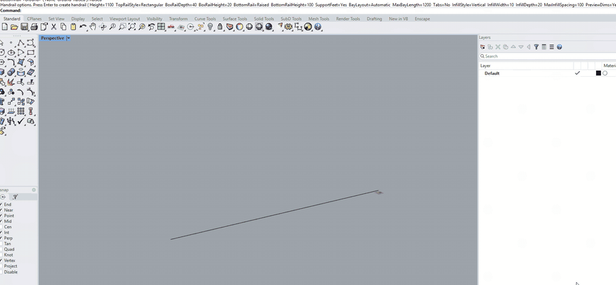

<p align="center">
  <picture>
    <source media="(prefers-color-scheme: dark)" srcset="assets/brand/numbat-icon-tile.svg">
    
  </picture>
</p>

# Numbat

Numbat is a collection of architectural modelling and analysis tools for Rhino 8. Commands use the `nb` prefix and are intended for small, repeatable production tasks that would otherwise require manual setup or repeated modelling operations.

## Installation

Requires Rhino 8 (8.21 or later) on Windows. Mac is not supported.

Open **Rhino Package Manager**, enable **Include pre-releases**, search for **Numbat**, and install the package.

See [CHANGELOG.md](CHANGELOG.md) for what changed in each release.

## Analysis commands

### nbGFA

Calculates gross floor area from selected closed polysurfaces. The command identifies the lowest face of each selected solid, validates that the face is horizontal and planar, rejects contained volumes, and reports the combined area in square metres.

## Modelling commands

### nbRandomColour

Randomises Rhino layer colours. Colours can be assigned independently to every layer or generated by top-level layer group with lighter nested-layer variations.

### nbTextureShuffle

Collects texture-mapping shuffle options for selected surfaces, polysurfaces and meshes. The current implementation reports the selected mapping settings but does not yet modify object texture mapping.

### nbPavementPlacer

Arrays a paving module along selected curves with controls for rows, gaps, rotation, scale variation, side and start-point behaviour.

<p align="center">
  
</p>

### nbHandrail

Generates configurable architectural handrails from selected curves. Available construction includes top and bottom rails, posts, vertical or zig-zag infill, framed panels, sheets, end tabs and support feet.

<p align="center">
  
</p>

## Commands in rework

nbStair, nbStairStraight, nbStairSpiral and nbPV have been withdrawn from the package for now while they are rebuilt to a more professional standard. They will come back in a later release. nbProgramBlocks and nbTemplate have been retired.

## Building from source

Requires the .NET 8 SDK (or newer) on Windows.

```powershell
dotnet build src/Numbat/Numbat/Numbat.csproj -c Release   # build net48 + net8.0 plug-ins
./scripts/Build-YakPackage.ps1                            # build and package into dist/*.yak
```

To debug, use the `Rhino 8 - netcore` launch profile, or drag `Numbat.rhp` from `bin/` into Rhino. Debug builds also include the commands that are in rework; release builds and the published package do not. Every push and pull request is built by CI, and the resulting `.yak` can be downloaded from the workflow run. Pushing a `v*` tag starts a release. The package first goes to McNeel's test Yak server for a final check, and it is published to Yak and GitHub Releases only after the maintainer approves.

## License

Numbat is licensed under the MIT License. See [LICENSE](LICENSE).
