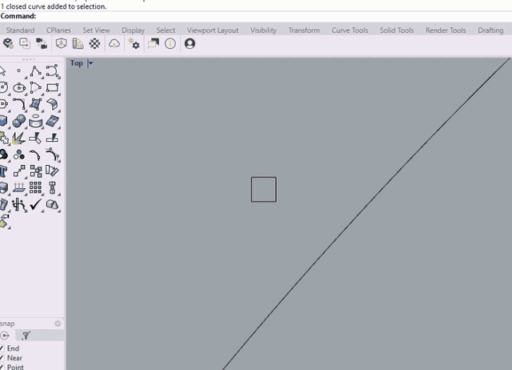

<p align="center">
  <picture>
    <source media="(prefers-color-scheme: dark)" srcset="assets/brand/numbat-icon-tile.svg">
    
  </picture>
</p>

# Numbat

Architectural modelling and analysis tools for Rhino 8. Every command starts with `nb`, so typing `nb` in Rhino lists them all.

| Command | What it does |
|---|---|
| [`nbGFA`](#nbgfa) | Live gross floor area tracking by use, with limits and a total target. |
| [`nbAF`](#nbaf) | Live Abstandsflächen (setback areas, HBauO § 6) with clash checks against neighbours and plots. |
| [`nbAnon`](#nbanon) | Finds a name (your company's, a client's) everywhere in a file and anonymises it. |
| [`nbTextureShuffle`](#nbtextureshuffle) | Breaks up repeating textures by shuffling their mapping. |
| [`nbHandrail`](#nbhandrail) | Configurable handrails with rails, posts, infill and panels. |
| [`nbPavementPlacer`](#nbpavementplacer) | Arrays a paving module along curves. |
| [`nbRandomColour`](#nbrandomcolour) | Randomises layer colours. |

## Installation

Requires Rhino 8.21 or later on Windows.

In Rhino, open the **Package Manager**, tick **Include pre-releases**, search for **Numbat** and click **Install**. What changed in each version is in the [changelog](CHANGELOG.md).

## nbGFA

Tracks gross floor area while you model. Model each storey as one closed box and give it a use (Residential, Office, ..., or Unassigned while you decide). A floating window shows each use's GFA and share of the total, flags uses outside their limits (% or m²), and warns when the total is off its target. GFA is reported in m².

The full guide is in [docs/nbGFA.md](docs/nbGFA.md), and in Rhino behind the window's **?** button.

Everything is done from the window. These helper commands are for macros and keyboard users. They don't appear as you type, but work when typed in full:

| Command | What it does |
|---|---|
| `nbGFAAssign` | Select volumes, then pick a use (or Exclude) on the command line. |
| `nbGFACheck` | Checks assigned volumes: open, tilted, no flat bottom, overlapping. |
| `nbGFAHelp` | Opens the guide. |
| `nbGFADemo` | Adds three example blocks (2, 4 and 6 storeys) to try nbGFA on. |

## nbAF

Draws the Abstandsflächen of a massing model: the areas in front of outer walls that German building codes require to be kept free. Model buildings the same way as for nbGFA (one closed box per storey, stacked; a pitched roof can be its own volume), and add them in the nbAF window. nbAF shows one Abstandsfläche per building face (stepped walls joined, as the Hamburg FAQ asks) as a live preview, checks every building against every other, and numbers and lists the clashes, explaining each one: overlapping areas, areas reaching into another building, and areas reaching another building's plot.

- **Rules:** Hamburg, HBauO § 6 (2025 text). Depth 0.4 H, at least 2.50 m (0.2 H in GE/GI). Roofs under 70° add a third of their height to H, steeper roofs all of it, and gable walls count up to the ridge. Every value can be changed in the window, for example when a Bebauungsplan sets other depths, and is saved in the file.
- **Roads:** add road centre lines and nbAF flags Abstandsflächen reaching past a road's middle (§ 6 Abs. 2).
- **Model check:** what looks exact often isn't. Volumes closer than 10 mm count as one building, buildings that almost touch are listed for you to join or keep apart, and Colour by building shows what nbAF counts as one building.
- **Bake** adds the result to `nbAF::` layers as closed curves, one per building face, in one undo step, with depth dimensions if you turned them on. **Export** saves a 2D top view as DXF, SVG (1:500) or JPG, in metres, with a legend: light blue Abstandsflächen, red clash zones, blue dashed plots, black footprints, and optional clash numbers, notes and dimensions.
- Not covered yet: Baulasten, boundary walls, ignorable projections, dormers and sloping ground.

The full guide is in [docs/nbAF.md](docs/nbAF.md), and in Rhino behind the window's **?** button. The legal texts, with saved copies, and which paragraphs are implemented are listed in [docs/sources/](docs/sources/README.md).

Everything is done from the window. These helper commands are for macros and keyboard users. They don't appear as you type, but work when typed in full:

| Command | What it does |
|---|---|
| `nbAFAdd` | Pick volumes to track. |
| `nbAFSetPlot` | Set a building's plot curve, for example `nbAFSetPlot B2`. |
| `nbAFAddRoad` | Pick curves to use as road centre lines. |
| `nbAFBake` | Bake the current result to the `nbAF` layers. |
| `nbAFClear` | Delete everything nbAF baked. The buildings stay tracked. |
| `nbAFSources` | List the legal texts and open the saved copy or the live page. |
| `nbAFHelp` | Opens the guide. |
| `nbAFDemo` | Adds an example district (some 450 storey volumes) to try nbAF on. Add them in the window like your own volumes. |

## nbAnon

Finds a word or phrase, such as your company's or a client's name, everywhere a Rhino file keeps text, and replaces it before you share the file. It looks in layer names, blocks (including everything inside nested blocks), object names, hyperlinks and user text, text and dimensions, groups, document user text and notes, named views, CPlanes, positions, layer states and layouts, linetypes, hatch and dimension styles, materials, and reports file paths. You review every place it was found, untick what should stay, and choose a random code, a random word, your own text or nothing as the replacement. All changes are one undo step, and the list can be saved as a report.

The guide is in [docs/nbAnon.md](docs/nbAnon.md), and in Rhino behind the window's **?** button (or `nbAnonHelp`).

## nbTextureShuffle

Breaks up obviously repeating textures such as brick, stone or timber cladding. Select surfaces, polysurfaces, meshes or SubDs, open the window and click **Shuffle** as often as you like. Each click moves their box mapping by a new random amount and is one undo step.

- **Repeat X / Y / Z**: the size of one texture repeat. Changing it resizes the selection's mapping straight away.
- **Align to**: World keeps neighbouring objects continuous; Object follows each object's largest flat face.
- **Same for all selected**: every selected object moves by the same amount; off, each gets its own.
- **Shift up to / along**: how far, and in which directions, the texture may move.
- **Straighten** puts the mapping back at its starting position. **Remove mapping** returns to Rhino's default mapping.

For macros, `-nbTextureShuffle` shuffles the selected objects once with the window's saved settings.

## nbHandrail

Builds a handrail along points you pick. Options include top and bottom rails, posts, vertical or zig-zag infill, framed panels, sheets, end tabs and support feet.

<p align="center">
  
</p>

## nbPavementPlacer

Arrays a paving module along curves, with options for rows, gaps, rotation, scale variation, side and start point.

<p align="center">
  
</p>

## nbRandomColour

Randomises layer colours, either per layer or per top-level layer group, with lighter shades for the layers nested inside.

## Commands in rework

nbStair, nbStairStraight, nbStairSpiral and nbPV are withdrawn for now while they are rebuilt to a more professional standard. They will return in a later release. nbProgramBlocks and nbTemplate have been retired.

## Building from source

Requires the .NET 8 SDK on Windows.

```powershell
dotnet build src/Numbat/Numbat/Numbat.csproj -c Release   # build the plug-in
./scripts/Build-YakPackage.ps1                            # build and package into dist/*.yak
```

To try a build, drag `Numbat.rhp` from `bin/` into Rhino. Debug builds also contain the commands in rework. Conventions, CI and the release process are described in [CLAUDE.md](CLAUDE.md).

## License

MIT. See [LICENSE](LICENSE).
