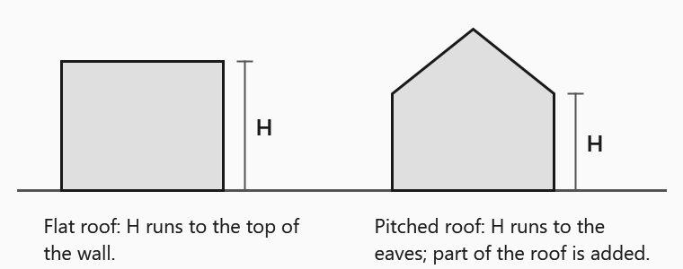
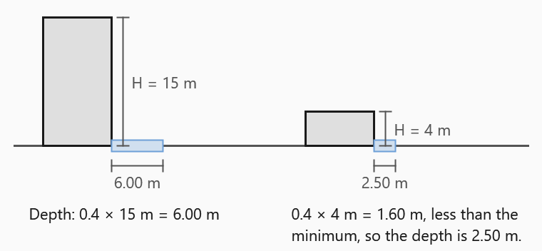
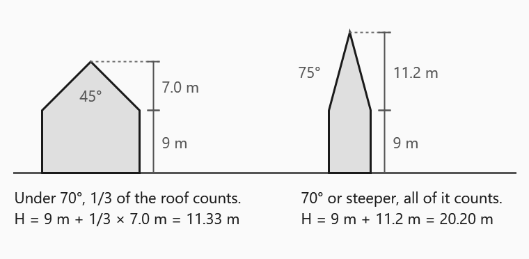
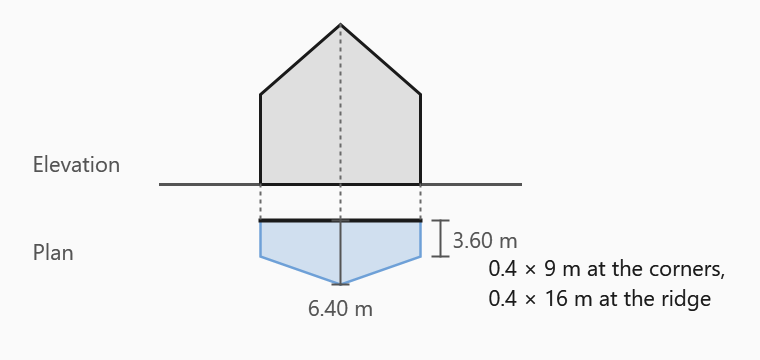
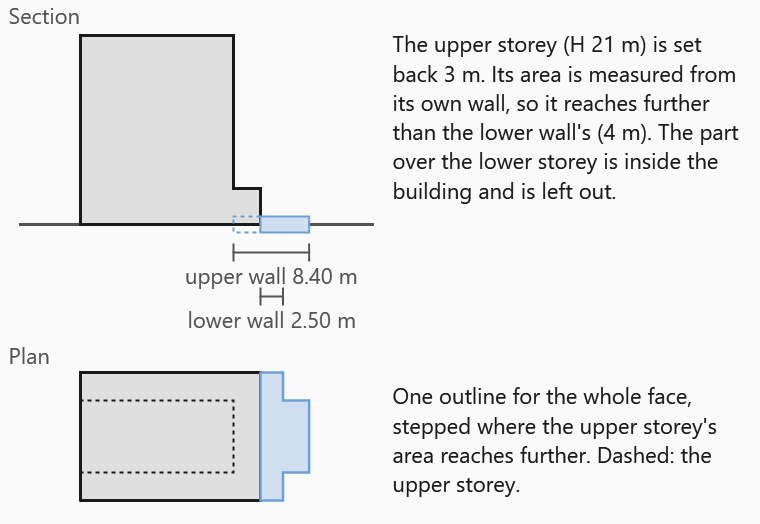
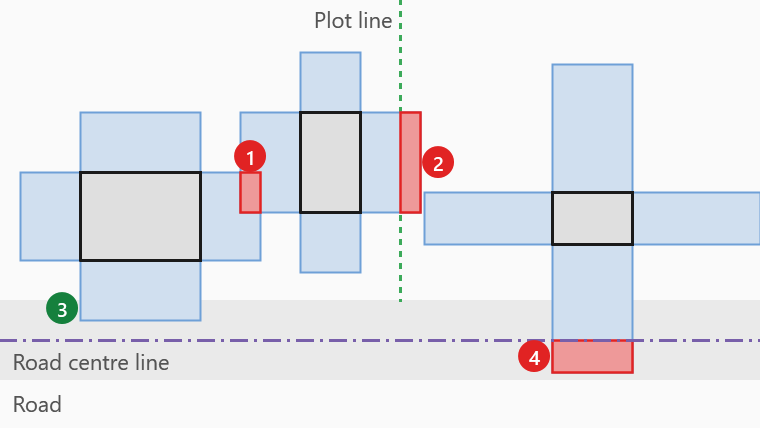

# How to use nbAF

nbAF draws the Abstandsflächen of your massing model: the areas in front of outer walls that German building codes require to be kept free. It checks every building against every other one, against the plot lines and against road centre lines, and exports the result as a 2D drawing. The rules are the Hamburg building code, HBauO § 6 (2025 text), and every number can be changed.

## The basics

An Abstandsfläche is the area in front of an outer wall that has to be kept free. Its depth depends on how high the wall is. The numbers below are the HBauO defaults.

- H is measured from the lowest point of the building to the top of the wall, or to the eaves where a pitched roof starts.

- The depth is 0.4 H, but at least 2.50 m. A low wall gets the minimum. In Gewerbe- and Industriegebiete (GE/GI) it is 0.2 H, at least 2.50 m.

- A roof flatter than 70° adds a third of its height to H. A roof of 70° or more adds all of it.

- A gable wall counts up to the ridge, so its Abstandsfläche is deepest in the middle and follows the shape of the gable.

- Each wall gets its own depth, measured from that wall. A set-back upper storey often needs a deeper area than the storey below it.
- The part of its area that lies over the building's own lower storeys is inside the building and is left out. Walls facing the same way are drawn as one outline.

- 1: Abstandsflächen must not overlap. Here two buildings are too close: a clash.
- 2: They must stay off the neighbour's plot: a clash.
- 3: They may reach into a public road, but only up to its middle: allowed.
- 4: Past the road's middle: a clash.
- Inside its own plot, an Abstandsfläche can lie anywhere, as long as no other building stands on it.

## 1. Model your buildings

- Model each building as stacked volumes: one closed box per storey (or part of a storey), as for nbGFA. A pitched roof can be its own volume on the top storey.
- Volumes that touch become one building. So do volumes closer than the join gap (10 mm unless you change it, see 9), so a tiny modelling gap doesn't split a building in two. Volumes in the same Rhino group are one building too, so you can join parts that don't touch.
- Work in millimetres or metres. Depths and areas are always shown in metres.

## 2. Open the window

- Type nbAF on the command line.
- The window stays on top. If you close it, type nbAF again and it reopens where you left it.
- While the window is open, the Abstandsflächen are drawn in the viewports as a live preview. Closing the window hides the preview. Nothing is added to your model until you click Bake.
- Top right, in the window's header: ? opens this guide (or press F1), and ⋯ opens the menu: this guide, the sources, Reset values, Reset colours, Update now, Delete baked output and the display options.
- Drag the window edges to resize it. If the content doesn't fit, the window scrolls.
- Every section (BUILDINGS, ROAD CENTRE LINES, CLASHES, MODEL, RULE VALUES, COLOURS) opens and closes with the arrow in front of its heading. A closed section shows how many items it holds. nbAF remembers which sections you closed.
- Two switches sit above BUILDINGS: Colour by building (on by default) and Depth labels (see 10).

## 3. Add buildings

- Select the volumes and click Add beside the BUILDINGS heading. With nothing selected, Add asks you to pick them on the command line.
- Each building gets a row: B1, B2, ... numbered from west to east.
- All buildings are treated the same: each one is checked against every other.
- Click a row to select the building's volumes. Right-click a row for more: select, set, select or clear the plot, or stop tracking the building.
- To stop tracking volumes, select them and click Remove. The volumes themselves are not deleted.
- nbAF remembers which volumes it tracks, their role and their plot on the volumes themselves, so it is saved with the file and survives copy and paste.

## 4. Plots

- Click Set plot on a building's row. If one closed curve is selected, it becomes the plot. Otherwise pick it on the command line.
- A row with a plot shows Plot. If the plot curve is deleted, the row shows Plot missing and the window says so.

## 5. Road centre lines

- Abstandsflächen may cover a public road, green or water area, but only up to its middle (§ 6 Abs. 2).
- Draw the centre line of each road next to the site as a curve, select the lines and click Add beside ROAD CENTRE LINES. With nothing selected, Add asks you to pick them. Draw them a little past the ends of the site.
- nbAF flags the part of an Abstandsfläche that goes past a centre line (on the side away from its wall), and lists one that ends within 0.5 m before it to check, in amber, since a centre line is often drawn roughly.
- Click a line in the list to select it; × stops using it as a centre line (the curve stays).

## 6. What you see

- Every face (side) of every building gets one Abstandsfläche: a filled area with an outline.
- Walls of one building that face the same way form one area together, also when they step back (set-back storeys). nbAF works out each wall's depth from its own position and height, then joins them into one outline, as the Hamburg FAQ on § 6 asks.
- The part of a set-back wall's area that lies over the building's own lower storeys is inside the building, so it is left out. The outline starts at the building's outer wall.
- The Clashes tile shows how many clashes there are. In the viewports each clash zone is filled in the clash colour with a numbered marker, and the CLASHES list in the window says what each number is. Hover over a clash in the list to see which rule it breaks, with the numbers (for example: two walls of B19 face each other 11.55 m apart, but their Abstandsflächen are 10.12 m and 5.32 m deep, 15.44 m together). Click it to zoom to it. Every pair of buildings is checked for:
- Abstandsflächen overlapping each other (§ 6 Abs. 3). This is allowed if the walls stand at more than 75° to each other, and stepped walls of one building facing the same way count as one. It applies within one building too: walls facing each other across a courtyard need their two depths between them ("Overlap within B19"). Where three or more overlap, each pair is listed.
- An Abstandsfläche reaching into another building.
- An Abstandsfläche lying on another building's plot.
- An Abstandsfläche going past a road centre line, if you have added them (see 5).
- An Abstandsfläche that leaves its own plot without reaching another plot or a road centre line is not flagged.
- Everything updates by itself shortly after you move or edit a tracked volume or a plot line.
- Plots are optional. Without any plots, nbAF says so in the window and checks only overlaps and areas reaching into buildings.
- The footer shows the result: the number of clashes, or that there are none.

## 7. Check the model

What looks exact on screen often isn't: two volumes drawn to touch can be 0.1 mm apart, and then nbAF sees two buildings whose Abstandsflächen clash with each other. nbAF checks the model every time it updates and says so above the results. Nothing is changed without you.

- Almost touching: buildings closer than 20 cm, but further apart than the join gap. Click Review to decide for each pair: Join makes them one building (nbAF puts the two closest volumes in a Rhino group), Keep apart tells nbAF they are separate and stops it asking, and Select shows them in the model. A clash between two such buildings says so in the CLASHES list, for example "B23 and B24 are 4 cm apart: one building?".
- Open objects: tracked objects that aren't closed volumes are left out. Click Select to find them, then Cap or Join them.
- Leaning walls: wall faces 2–15° off vertical get no Abstandsfläche.
- Curved walls: skipped, with the number of faces.
- Colour by building (the switch above BUILDINGS, on by default) tints each building in its own colour and labels it B1, B2, ..., so you can see at a glance what nbAF counts as one building. Buildings within 40 m of each other never share a colour, and each row in BUILDINGS shows its building's colour.

Walls that are almost flat (within 5 mm) count as flat, and walls of one building within 1° of each other count as facing the same way.

## 8. How the depth is worked out

- H is the wall height from the lowest point of the building to the top of the wall, or to where the wall meets the roof.
- A roof flatter than 70° adds one third of its height to H. A steeper roof adds all of it.
- A gable wall counts up to the ridge, so its Abstandsfläche follows the shape of the gable.
- Each part of a façade takes the height of the tallest volume above it. An upper storey that is set back, or covers only part of the floor below, gets its own depth.
- Depth = 0.4 H, at least 2.50 m. In Gewerbe- and Industriegebiete (zone GE/GI) it is 0.2 H, at least 2.50 m.
- Only flat walls get Abstandsflächen. Curved walls are skipped, and the window says how many.

## 9. Change the values

- The RULE VALUES section shows every number nbAF uses, with its paragraph in HBauO § 6. Click a value to change it, for example to 0.8 H when a Bebauungsplan sets that. Fractions such as 1/3 are accepted.
- Click Zone to switch between the general rule and GE/GI.
- A changed value is highlighted and shows its default underneath. The window says that the values differ from the HBauO defaults, and Reset brings them back.
- The MODEL section above the values holds the join gap: volumes closer than this count as one building. It isn't part of HBauO, so it isn't reset with the values.
- The values are saved in the Rhino file.

## 10. Display

- Click a colour in the COLOURS section to change it. The colours apply to the preview, to new baked layers and to exports, and are remembered for your next files.
- Layers that were baked before keep their colour. Change them in the Layers panel.
- Colour by building tints each building in its own colour and labels it (see 7).
- Depth labels is off by default, so only clashes are marked. Turn it on to show a depth dimension for each wall: a line with ticks from the middle of the wall straight out to the edge of its Abstandsfläche, with the depth written beside it.
- The dimensions are drawn on the ground, like dimensions on a plan, and read from the bottom or the right. They grow and shrink as you zoom, and text too small to read is hidden until you zoom in. A gable wall's dimension gives the depth at the middle of the wall.
- A wall gets no dimension where its whole area lies over the building itself, or inside the area of a higher wall of the same face. Where two dimensions would overlap, the deeper wall keeps its dimension.

## 11. Bake

- Click Bake to add the result to your model as closed curves, on sublayers of an "nbAF" layer: Areas, Clashes, Plots, Footprints and Labels.
- Each building face is one closed curve, named for example "B3 south, depth 5.12 m". Each clash zone is a closed curve with a numbered dot; hover over the dot to see what the clash is.
- With Depth labels on, the depth dimensions are baked too, as Rhino dimensions on the Labels layer in your current dimension style, with the text set to the depth in metres. Each dimension's name (in Properties) says how H was worked out for that wall.
- Baking again replaces what was baked before. Each bake is one undo step.
- ⋯ > Delete baked output removes everything on the nbAF layers. The buildings stay tracked.

## 12. Export

- Click Export and choose DXF, SVG or JPG. The drawing is a 2D top view in metres with a legend, the values and the source. It always uses the same drawing style, whatever the colours in the window:
- Abstandsflächen: one closed light blue outline per building face, with a pale blue fill in SVG and JPG.
- Clashes: separate closed red outlines, with a pale red fill in SVG and JPG.
- Plot lines: blue dashed lines. Building footprints: black outlines filled white.
- In the Export menu, choose what else goes in: Clash zones, Clash numbers (red numbered markers, also listed under the legend), Clash notes (what each clash is and its area, in two short lines) and Depth dimensions. nbAF remembers your choice.
- DXF has one layer per element. SVG is at 1:500.

## 13. Display options

- ⋯ > Interface size makes the window and its text larger (100 %, 115 % or 130 %).
- ⋯ > Stronger outlines draws darker borders on buttons, rows and dividers.
- These options are shared with the other Numbat windows. The window follows Rhino's light or dark mode.

## Not covered yet

- Green and water areas for the half-way rule: draw their centre lines as road centre lines. Baulasten are not covered.
- Walls built on the plot boundary, balconies and other projections that may be ignored, dormers, and sloping ground.
- Averaging irregular Abstandsflächen (Flächenausgleich). nbAF stays on the safe side.
- Other Länder. Most follow the Musterbauordnung (0.4 H, at least 3 m), so for many of them changing the minimum depth is enough. Check the current law first.

## Commands

- nbAF: opens the window, or brings it to the front.
- nbAFAdd: picks volumes to add on the command line.
- nbAFSetPlot: sets a building's plot, for example nbAFSetPlot B2.
- nbAFAddRoad: picks curves to use as road centre lines.
- nbAFBake: bakes the current result to the nbAF layers.
- nbAFClear: deletes everything nbAF baked.
- nbAFSources: lists the legal texts and opens the saved copy or the live page.
- nbAFDemo: adds an example district of about 450 storey volumes on an "nbAF demo" layer, so you can try nbAF straight away. It comes from a real hand-made model and keeps its small modelling gaps, so it also shows the model check at work. The volumes aren't added to nbAF: open the nbAF window, select them and click Add, as with your own model. It has no plots. Running it again replaces them.
- nbAFHelp: shows this guide. You can also open it with the ? button in the window, or press F1 there.

All but nbAF are hidden: they don't appear as you type, but work when typed in full.
